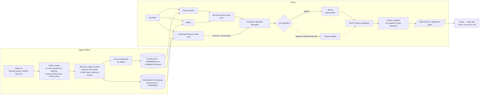

# rag-demo: crawl → index → retrieve → analyze

> **Status.** The local pipeline is measured end to end (numbers below). **The AnythingLLM integration was tested live** against AnythingLLM **v1.17.0** (Docker image `mintplexlabs/anythingllm`, built 2026-10-05) on **2026-10-05**: the full corpus was ingested, a 50-question retrieval eval was run and an example was answered. **The Claude adapter is implemented** and covered by mocked tests. It has **not** been run against the live API, and no paid API calls were made anywhere in this repo.

| | |
|---|---:|
| Page hit@5, local hybrid retriever (50 questions) | **96%** |
| Page hit@5, AnythingLLM workspace retrieval (same questions) | **96%** |
| Model quotes matched in the cited passage (gemma2:9b, 75 quotes) | **85.3%** |

A small, readable retrieval-augmented generation (RAG) pipeline that runs entirely on free, local models. It crawls a documentation site politely and chunks it along the document's structure. It then retrieves with hybrid dense + BM25 search, either from its own index or from an **AnythingLLM workspace**. A local LLM answers in JSON that is validated against a JSON Schema, and every citation is checked in code.

**Live results page:** <https://rag-demo-flask.vercel.app>. It shows precomputed queries, retrieved passages, citations, eval numbers and the AnythingLLM run. No model runs when you open it.

This is a demo, not a product. All numbers come from running this code on one corpus with a question set I wrote by hand. They are reported as measured, including the ones that don't favour my own retriever.

## Results

Corpus: the [Flask documentation](https://flask.palletsprojects.com/en/stable/) (3.1.x, extracted 2026-10-05; see [THIRD_PARTY_NOTICES.md](THIRD_PARTY_NOTICES.md)). 74 content pages became 1,093 chunks, each at most 1,500 characters. Measured on a Mac mini (M4 Pro, 2024) running ollama 0.15.

### Retrieval: local index (50 hand-labelled questions)

`page` counts a hit when a top-k chunk comes from a labelled page. `section` is stricter: the chunk must come from the labelled section or API entry. Each retriever ranks 50 candidates, and MRR is computed over them (MRR@50). Source: [`eval/results.json`](eval/results.json), which also stores each retriever's top 5 and first relevant page and section rank for every question.

| Retriever | page hit@1 | @3 | @5 | @10 | MRR@50 | section hit@1 | @3 | @5 | @10 | MRR@50 |
|---|---:|---:|---:|---:|---:|---:|---:|---:|---:|---:|
| Dense (nomic-embed-text) | 72% | 82% | 88% | 96% | 0.797 | 52% | 66% | 70% | 80% | 0.619 |
| BM25 baseline | 70% | 90% | 94% | 94% | 0.796 | 52% | 76% | 84% | 86% | 0.649 |
| **Hybrid RRF (default)** | 74% | 88% | 96% | 100% | 0.825 | 58% | 76% | 90% | 98% | 0.704 |

On this corpus, plain BM25 beat dense embeddings at the section level, likely because many questions hinge on exact identifiers such as `MAX_CONTENT_LENGTH`. Reciprocal-rank fusion had the best hit@5 and MRR at both the page and section level, so `hybrid` is the default. BM25 alone still wins page hit@3.

### Retrieval: AnythingLLM workspace vs. local, same questions, same depth

AnythingLLM returned its top 10 through `POST /api/v1/workspace/{slug}/vector-search`. To compare like with like, the local retrievers were re-scored on the same 50 questions with 10 candidates each. Source: [`eval/anythingllm_results.json`](eval/anythingllm_results.json).

| Retriever (top 10) | page hit@1 | @3 | @5 | @10 | MRR@10 | section hit@1 | @3 | @5 | @10 | MRR@10 |
|---|---:|---:|---:|---:|---:|---:|---:|---:|---:|---:|
| **AnythingLLM 1.17.0 workspace** (nomic-embed-text, LanceDB) | 72% | 90% | 96% | 98% | 0.816 | 48% | 74% | 78% | 86% | 0.625 |
| Local dense (nomic-embed-text, task prefixes) | 72% | 82% | 88% | 96% | 0.794 | 52% | 66% | 70% | 80% | 0.609 |
| Local BM25 | 70% | 90% | 94% | 94% | 0.792 | 52% | 76% | 84% | 86% | 0.642 |
| Local hybrid RRF | 74% | 92% | 94% | 96% | 0.823 | 58% | 74% | 80% | 90% | 0.679 |

What this shows: AnythingLLM's dense retrieval beat my dense retriever at the page level (96% vs 88% page hit@5) with the same embedding model. One likely reason is that AnythingLLM prepends a metadata header (title and source URL) to every chunk it embeds. At depth 10, local hybrid section hit@5 was 80%, against AnythingLLM's 78% and BM25's 84%. Hybrid had the highest section hit@10 (90%) and MRR@10 (0.679). With the default 50 candidates, its section hit@5 was 90%. Average AnythingLLM vector-search latency was 195 ms per question over HTTP, against 20.3 ms in-process for the local index (all three local retrievers, including the query embedding; `eval/results.json`). Latency figures and the AnythingLLM numbers each come from a single run on one machine (the AnythingLLM numbers from one fresh ingest).

### End-to-end answers (local hybrid retrieval + gemma2:9b)

The full pipeline ran over the same 50 questions plus 5 out-of-corpus "trap" questions (Django, Express, Kubernetes and so on) that it should refuse. All metrics are mechanical checks; no LLM grades another LLM. Source: [`eval/answer_results.json`](eval/answer_results.json), with one row per question and a run manifest.

| Metric | Result |
|---|---:|
| Answers with at least one valid citation (the ref points at a supplied passage) | 98% |
| Answers whose inline `[n]` markers are present and all valid | 94% |
| Model-supplied quotes matched in the cited passage after whitespace, case and backtick normalization | 85.3% (75 quotes) |
| Answers citing a labelled target page | 80% |
| In-corpus questions wrongly refused | 2% (1 of 50) |
| Out-of-corpus trap questions correctly refused | 100% (5/5) |
| Model outputs rejected (schema violation, truncation or refusal) | 0 of 55 |
| Median LLM latency per answer (gemma2:9b, local) | 12.6 s |
| Wall clock for all 55 questions | 12 min |

## AnythingLLM integration

`rag_demo/anythingllm.py` talks to AnythingLLM's Developer API. The routes it uses were checked against the running instance's Swagger at `/api/docs` and are listed at the top of that module.

```bash
export ANYTHINGLLM_BASE_URL=http://localhost:3001       # default
export ANYTHINGLLM_API_KEY=...                          # Settings > Developer API; never commit it
python -m rag_demo anythingllm ingest --dry-run          # show the plan
python -m rag_demo anythingllm ingest                    # upload + embed (1,093 docs in 112 s here)
python -m rag_demo anythingllm eval                      # page/section hit@k via workspace vector-search
python -m rag_demo anythingllm ask "How do I limit upload size?" --format markdown
```

- **Ingest:** each chunk is uploaded with `POST /v1/document/raw-text` as one document. Its metadata is `title` = breadcrumb, `url`/`docSource` = deep link, `chunkSource` = `rag-demo-chunk:<chunk id>`, plus the corpus license. The returned document `location`s are attached with `POST /v1/workspace/{slug}/update-embeddings` in batches. The workspace is created in `query` mode if it does not exist yet.
- **Ownership and duplicate policy, so reruns are safe:** every document carries the marker `rag-demo:<workspace>:<sha1(chunk id)>:<content hash>`. Ingest only ever touches documents whose marker names *its own* workspace. Unchanged chunks are skipped. A changed chunk is uploaded and embedded first. Its old document is retired only after every new copy is verified in the workspace, so a failed upload keeps the working version, and the command exits non-zero with the failures written to the manifest. Owned documents for chunks that no longer exist are deleted (`--no-prune` keeps them). A document that another workspace still embeds is detached but never deleted. In the live run, a second `ingest` uploaded nothing and finished in 0.3 s ([`eval/anythingllm_ingest_rerun.json`](eval/anythingllm_ingest_rerun.json)).
- **Ask:** `POST /v1/workspace/{slug}/chat` with `mode: "query"`. AnythingLLM's returned `sources` become the passages for this repo's analysis layer. Each passage keeps its provenance: retriever, AnythingLLM document id, score and original chunk id. The output records `retriever: "anythingllm/<slug>"`, so it can't be confused with local-retriever output. AnythingLLM's own answer is kept in a separate field for comparison and is never used for citations. Example: [`eval/anythingllm_example.md`](eval/anythingllm_example.md).
- **What was verified live:** 1,093 documents were uploaded and embedded with 0 failures, and the workspace reported 1,093 documents and 1,093 vectors, so AnythingLLM did not re-split the ≤1,500-character chunks. The instance's embedder maximum chunk length was 8,192 (recorded in `instance_settings`). After ingest, a fingerprint of the ownership markers the workspace actually embeds is computed and compared with the fingerprint the local corpus should produce. They matched, and the workspace held no other documents (`foreign_documents: 0`). A foreign document would make ingest report `incomplete` and block `export`; it is never deleted automatically. The eval and the example record the same workspace fingerprint, and `export` refuses to publish AnythingLLM numbers if any of these disagree. The redacted ingest manifest is [`eval/anythingllm_ingest.json`](eval/anythingllm_ingest.json).
- **Test instance:** `mintplexlabs/anythingllm` in Docker. Its version, 1.17.0, was read from the container's `server/package.json`; the API exposes no version route, so artifacts carry it from `ANYTHINGLLM_VERSION`. The instance used ollama on the host for both the LLM (`gemma2:9b`) and embeddings (`nomic-embed-text`), with LanceDB and no cloud keys. The eval manifest records the workspace settings (query mode, topN 5, similarity threshold 0, default vector-search mode) and the effective instance settings (ollama embedder `nomic-embed-text:latest`, LanceDB, ollama LLM `gemma2:9b`). Other versions or vector databases may behave differently. Re-run `anythingllm eval` before relying on these numbers.
- **Not covered:** AnythingLLM's streaming chat, threads, agents and file-upload routes; the Claude adapter on top of AnythingLLM sources. The code path exists, but it was not run because it would cost money.

## Architecture



| Module | Job |
|---|---|
| `rag_demo/crawl.py` | robots.txt handling, one paced fetcher for every request, scope-checked manual redirects (at most 5), backoff on 429/5xx, identifying User-Agent, on-disk cache |
| `rag_demo/chunk.py` | Walks Sphinx `<section>` and `<dl class="py">` trees. Each chunk keeps a breadcrumb and a deep link. Size is hard-bounded, and code fences stay balanced. |
| `rag_demo/embed.py` | ollama `/api/embed` with nomic's task prefixes; rejects zero or non-finite vectors |
| `rag_demo/index.py` | Immutable index generations behind an atomically switched symlink (the one-time migration of a pre-0.2 index directory is not atomic but is repaired automatically on the next build or load); load-time validation of the chunks fingerprint, the embeddings checksum, the model, rows, dimensions and finite values |
| `rag_demo/retrieve.py` | Dense, BM25 and RRF hybrid retrievers, with `k`, mode and depth validation |
| `rag_demo/llm.py` | `LLM` protocol: `OllamaLLM` (default) and `ClaudeLLM` (optional), with truncation and refusal handling |
| `rag_demo/pipeline.py` | Prompt with an injection boundary, JSON Schema validation, citation checks |
| `rag_demo/anythingllm.py` | AnythingLLM client, ingest, ask, eval |
| `rag_demo/evaluate.py` / `answer_eval.py` | Retrieval and end-to-end grounding evals |
| `rag_demo/manifest.py` / `export.py` | Run manifests; refuses to mix incompatible artifacts; builds `site/data.json` |
| `rag_demo/log.py` | Structured logging to stderr (`RAG_LOG_FORMAT=json` for JSON lines) |

## Quickstart

Prerequisites: Python 3.12+ and [ollama](https://ollama.com).

```bash
git clone https://github.com/cheddarlebel-lab/rag-demo && cd rag-demo
python3 -m venv .venv && . .venv/bin/activate
pip install --require-hashes -r requirements.lock   # fully pinned, hash-checked (requirements.txt lists the direct deps)

ollama pull nomic-embed-text             # 274 MB
ollama pull gemma2:9b                    # 5.4 GB; see RAG_CHAT_MODEL

python -m rag_demo crawl                 # ~76 requests at ≥1 s each; cached afterwards
python -m rag_demo index                 # chunk + embed
python -m rag_demo eval                  # retrieval eval
python -m rag_demo ask "How do I limit the size of uploads?"
python -m rag_demo ask "..." --retrieve-only --mode bm25 -k 10
python -m rag_demo eval --answers        # plus the end-to-end grounding eval (slow)
python -m rag_demo export                # rebuild site/data.json (refuses stale or mismatched artifacts)
```

Results go to stdout as JSON, and logs go to stderr. Exit code 2 means invalid input or invalid model output, and exit code 1 means a refused crawl, an AnythingLLM error or incompatible artifacts.

### Docker

ollama stays on the host, where it can use the GPU:

```bash
docker build -t rag-demo .
docker run --rm -v "$PWD/data:/app/data" rag-demo crawl
docker run --rm -v "$PWD/data:/app/data" rag-demo index
docker run --rm -v "$PWD/data:/app/data" rag-demo ask "How do I add a CLI command?"
docker run --rm -v "$PWD/data:/app/data" -v "$PWD/eval:/app/eval" -v "$PWD/site:/app/site" rag-demo export
```

Mount `site/` and `eval/` when you want to keep exported files. On Linux, add `--add-host=host.docker.internal:host-gateway`.

### Configuration

| Env var | Default | |
|---|---|---|
| `RAG_SEED` / `RAG_PREFIX` | Flask stable docs | Another site also needs `RAG_CORPUS_NAME` and `RAG_CORPUS_LICENSE` (the export refuses without them). Check that site's license, robots.txt and terms yourself. |
| `RAG_MAX_PAGES` | 120 | Crawl cap |
| `RAG_CRAWL_DELAY` | 1.0 | Seconds between requests. Values below 1.0 are raised to 1.0, and a larger robots `Crawl-delay` wins. |
| `OLLAMA_HOST` | `http://localhost:11434` | |
| `RAG_EMBED_MODEL` | `nomic-embed-text` | The index refuses to load if it was built with a different model |
| `RAG_CHAT_MODEL` | `gemma2:9b` | All published numbers use it. (Informal observation, not a published measurement: `llama3.1:8b` and `qwen2.5-coder:7b` often left `citations` empty.) |
| `RAG_RETRIEVER` | `hybrid` | `dense`, `bm25` or `hybrid` (anything else is an error) |
| `RAG_TOP_K` / `RAG_CANDIDATE_DEPTH` | 5 / 50 | Passages given to the LLM / candidates each retriever ranks |
| `RAG_LLM` | `ollama` | `claude` switches to the Anthropic adapter |
| `RAG_CLAUDE_MODEL` | none | Required with `RAG_LLM=claude` |
| `ANYTHINGLLM_BASE_URL` / `ANYTHINGLLM_API_KEY` / `ANYTHINGLLM_WORKSPACE` | `http://localhost:3001` / none / `flask-docs` | |
| `RAG_LOG_FORMAT` / `RAG_LOG_LEVEL` | `text` / `INFO` | `json` emits one JSON object per log line |

## Using Claude instead of a local model (optional)

`ClaudeLLM` uses the official `anthropic` SDK with structured outputs (`output_config.format` set to the pipeline's JSON schema). It treats `stop_reason: "refusal"`, `"max_tokens"` (truncation), a missing text block and invalid JSON as errors with clear messages. Its output then goes through the same schema validation and citation checks as the local model's.

```bash
pip install -r requirements-claude.txt
export ANTHROPIC_API_KEY=...
RAG_LLM=claude RAG_CLAUDE_MODEL=claude-opus-5-5 python -m rag_demo ask "How do I stream a large response?"
RAG_LLM=claude RAG_CLAUDE_MODEL=claude-opus-5-5 python -m rag_demo anythingllm ask "..."   # AnythingLLM sources → Claude
```

There is no default model; leaving `RAG_CLAUDE_MODEL` unset is an error. The request shape and failure handling are covered by mocked tests (`tests/test_llm.py`), but **the adapter has not been run against the live API**. No number in this repo or on the results page comes from Claude.

## Extending

Each extension point is one small interface. Add a test next to the existing ones, then keep `ruff check`, `mypy` and `pytest` green.

- **Another LLM backend** (OpenAI-compatible server, vLLM, Bedrock): add a class with `name` and `complete_json(system, user, schema) -> dict` to `llm.py`, and register it in `get_llm`. It must raise `LLMOutputError` on truncation or refusal. Schema validation and citation checks are applied afterwards, so the backend does not need to implement them.
- **Another retriever** (for example a reranker): add a mode to `config.RETRIEVERS` and a branch in `Retriever.search`/`rankings`. `evaluate.metrics` scores any list of `(url, anchor)` hits, which is how the AnythingLLM eval reuses it.
- **Another vector store** (pgvector, Qdrant, LanceDB): replace `Index` (build, load and validation) *and* the dense scoring in `Retriever`, which reads `Index.vecs` directly. Swapping `Index` alone is not enough.
- **Another source of passages** (a search API, another RAG server): map each result to `{rank, link, breadcrumb, kind, text, provenance}` and call `pipeline.analyze(question, passages, llm, retriever="<name>", retrieval_ms=...)`, as `anythingllm.ask` does.
- **Another corpus:** set `RAG_SEED`, `RAG_PREFIX`, `RAG_CORPUS_NAME` and `RAG_CORPUS_LICENSE`. The chunker targets Sphinx HTML. Other generators need their own `chunk_page`, and the eval needs a new hand-labelled `eval/questions.jsonl`.

## Quality gates and evidence

CI ([`.github/workflows/ci.yml`](.github/workflows/ci.yml)) installs from the hash-pinned `requirements-dev.lock`. It runs `ruff`, `mypy --strict` on the package and `pytest` on Python 3.12 and 3.13, and builds the Docker image, which installs from `requirements.lock`. The suite has 104 tests. They run fully offline: `requests` is patched so that any real network call fails the test.

| Claim | Evidence |
|---|---|
| The crawler checks scope and robots.txt on the exact URL `requests` will send (dot segments resolved or rejected), validates the seed and every redirect hop, paces every request including robots.txt, refuses on robots 401/403, backs off then stops on 429/5xx, and enforces a 1 s floor | `tests/test_crawl.py` |
| Chunks are at most 1,500 characters with balanced code fences | `tests/test_chunk.py`; for the 1,093 published chunks, `eval/results.json` → `corpus` records `longest_chunk_chars: 1498` and `chunks_with_unbalanced_fences: 0` |
| Model output is schema-validated; truncation and refusals are errors | `tests/test_pipeline.py`, `tests/test_llm.py` |
| An empty or normalization-empty quote never counts as matched | `test_quote_normalization`, `test_analyze_verifies_citations` |
| Passages are delimited and cannot forge delimiters | `test_prompt_injection_boundary` |
| `k`, mode and depth are validated; an empty corpus gives a clear error; the index validates on load, including same-row-count corruption; publishing a new generation is atomic, and an interrupted build leaves the old index in place; an interrupted one-time legacy migration can briefly leave the index path missing, and the next load or build repairs it | `tests/test_retrieve.py` |
| The committed `site/data.json` has every field the page renders, and the site ships the license notice | `tests/test_site_data.py` |
| AnythingLLM payloads, auth header, per-workspace ownership, foreign-document detection, the failure-safe replacement order, failure manifests for every phase, no redirects with the key, key redaction and provenance | `tests/test_anythingllm.py` (mocked); live run in `eval/anythingllm_*.json` |
| Every published number | `eval/*.json`. Each eval artifact carries a run manifest with the corpus and question-set fingerprints and the models and settings that apply to it, and `export` refuses to combine mismatched artifacts. |

## Design notes and limits

- **Why chunk by structure?** Documentation already has the right boundaries. Section and API-entry chunks also give each citation a precise deep link.
- **Why no vector database for the local index?** About 1,100 768-dimensional float32 vectors take 3.4 MB, and exact search is one matrix-vector product. The AnythingLLM path covers a "real" store (LanceDB inside AnythingLLM).
- **What the citation check proves:** the cited passage was supplied to the model, and the quote appears in it after whitespace, case and backtick normalization. It does *not* prove the answer is complete or correct; that needs human review or a judged eval.
- **Prompt injection:** passages are labelled as untrusted and delimited, but that reduces the risk rather than removing it. See [SECURITY.md](SECURITY.md).
- **Failure cases are left on the results page.** For the CSRF question, the right section was not retrieved, so the model refused rather than answer from memory. For the upload-size question, the answer is right, but the model's "quote" is a paraphrase that appears in none of the passages, so the validator marks it *not matched* instead of trusting it. (In an earlier run of this pipeline, the nginx question was refused even though the ProxyFix passage was retrieved. In this run it was answered from that passage, so outputs from a 9B model vary between runs.)
- **Eval caveats:** 50 questions is a small set, and I wrote them myself. Treat the numbers as a regression baseline for this corpus, not as a benchmark.
- **Crawler etiquette:** the default delay is one second between all requests, including robots.txt and redirect hops. A larger robots.txt `Crawl-delay` wins, and the delay cannot be configured below one second. robots.txt is fetched on each run; cached pages are reused. Robots permission is not the same as permission under a site's terms of service. I have not reviewed any site's terms on your behalf.

## License

Code: MIT ([LICENSE](LICENSE)). Corpus excerpts: Flask documentation © 2010 Pallets, BSD-3-Clause. The full notice is in [THIRD_PARTY_NOTICES.md](THIRD_PARTY_NOTICES.md). This project is not affiliated with Pallets.
