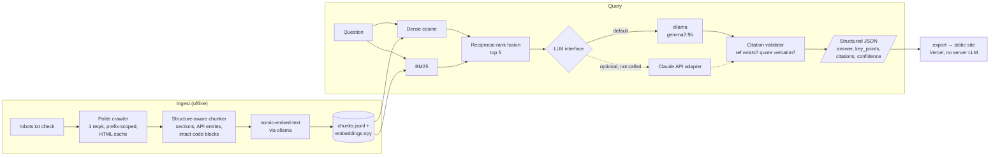

# rag-demo: crawl → index → retrieve → analyze

A small, readable, end-to-end retrieval-augmented generation (RAG) pipeline that runs entirely on free, local models. It crawls a documentation site politely, chunks it along the document's structure, embeds it with `nomic-embed-text`, retrieves with hybrid dense + BM25 search, and has a local LLM answer in schema-validated JSON with citations. Every citation is then checked in code.

**Live results page:** <https://rag-demo-flask.vercel.app> (precomputed queries, retrieved passages, citations and eval numbers; no model runs when you open it).

This is a demo, not a product. The numbers below come from running this code on one corpus with a hand-written question set. They are reported as measured, including the ones that didn't favour embeddings.

## Measured results

Corpus: the [Flask documentation](https://flask.palletsprojects.com/en/stable/) (BSD-3-Clause). 74 content pages became 1,093 chunks. Measured on a Mac mini (M4 Pro, 2024) running ollama 0.15, on 2026-10-05.

### Retrieval (50 hand-labelled questions)

`page` counts a hit when a top-k chunk comes from a labelled page. `section` is stricter: the chunk must come from the labelled section or API entry.

| Retriever | page hit@1 | page hit@3 | page hit@5 | page hit@10 | page mrr | section hit@1 | section hit@3 | section hit@5 | section hit@10 | section mrr |
|---|---:|---:|---:|---:|---:|---:|---:|---:|---:|---:|
| Dense (nomic-embed-text) | 72% | 82% | 88% | 96% | 0.797 | 52% | 66% | 70% | 80% | 0.619 |
| BM25 baseline | 70% | 90% | 94% | 94% | 0.796 | 52% | 76% | 84% | 86% | 0.649 |
| **Hybrid RRF (default)** | 74% | 88% | 96% | 100% | 0.825 | 58% | 76% | 90% | 98% | 0.704 |

Average dense query latency, including the query embedding: 20.3 ms. Brute-force cosine over 1,093 vectors takes under 1 ms of that.

**What I learned:** on this corpus, plain BM25 beat dense embeddings at the section level. Questions often hinge on exact identifiers such as `MAX_CONTENT_LENGTH` or `url_for`. Reciprocal-rank fusion of the two beat both, so `hybrid` is the pipeline default (`RAG_RETRIEVER=dense|bm25|hybrid`).

### End-to-end answers (retrieval plus a local LLM)

The full pipeline ran over the same 50 questions plus 5 out-of-corpus "trap" questions (Django, Express, Kubernetes and so on) that it should refuse. All metrics are mechanical checks. No LLM grades another LLM.

| Metric | Result |
|---|---:|
| Answers with at least one valid citation (ref points at a retrieved passage) | 96% |
| Answers whose inline `[n]` markers are present and all valid | 92% |
| Model-supplied quotes found verbatim in the cited passage | 87.1% |
| Answers citing a labelled target page | 82% |
| In-corpus questions wrongly refused | 4% |
| Out-of-corpus trap questions correctly refused | 100% (5/5) |
| Median LLM latency per answer (gemma2:9b, local) | 12.2 s |
| Wall clock for all 55 questions | 12 min |

Per-question rows are in [`eval/answer_results.json`](eval/answer_results.json), and retrieval rankings are in [`eval/results.json`](eval/results.json).

## Architecture



| Module | Job |
|---|---|
| `rag_demo/crawl.py` | robots.txt parsing, crawl delay of at least 1 s (a larger robots `Crawl-delay` wins), prefix scoping, URL normalisation, identifying User-Agent, on-disk cache |
| `rag_demo/chunk.py` | Walks Sphinx `<section>` and `<dl class="py">` trees. Each chunk keeps a breadcrumb (`Configuration Handling > Builtin Configuration Values > MAX_CONTENT_LENGTH`) and a deep link used as the citation target. |
| `rag_demo/embed.py` | ollama `/api/embed` with nomic's `search_document:` / `search_query:` task prefixes, unit-normalised |
| `rag_demo/index.py` | Builds and loads the index (JSONL plus a NumPy matrix; exact search at this size) |
| `rag_demo/retrieve.py` | Dense, BM25 and RRF hybrid retrievers |
| `rag_demo/llm.py` | `LLM` protocol with `OllamaLLM` (default) and `ClaudeLLM` (optional) |
| `rag_demo/pipeline.py` | Prompt, JSON schema, citation validation |
| `rag_demo/evaluate.py` | hit-rate@k and MRR for dense, BM25 and hybrid |
| `rag_demo/answer_eval.py` | End-to-end grounding metrics and trap questions |
| `rag_demo/export.py` | Precomputes `site/data.json` for the static page |

## Run it in 15 minutes

Prerequisites: Python 3.10+ and [ollama](https://ollama.com).

```bash
git clone https://github.com/cheddarlebel-lab/rag-demo && cd rag-demo
python3 -m venv .venv && . .venv/bin/activate
pip install -r requirements.txt

ollama pull nomic-embed-text      # 274 MB
ollama pull gemma2:9b             # 5.4 GB; any chat model works, see RAG_CHAT_MODEL

python -m rag_demo crawl          # ~76 requests at 1 req/s, about 1.5 min; cached afterwards
python -m rag_demo index          # chunk + embed, about 20 s on Apple silicon
python -m rag_demo eval           # retrieval eval, a few seconds
python -m rag_demo ask "How do I limit the size of uploads?"
```

Example output (trimmed):

```json
{
  "question": "How do I limit the size of uploads?",
  "answer": "Set the MAX_CONTENT_LENGTH config key, e.g. app.config['MAX_CONTENT_LENGTH'] = 16 * 1000 * 1000 [1] ...",
  "key_points": ["..."],
  "citations": [
    {"ref": 1,
     "link": "https://flask.palletsprojects.com/en/stable/patterns/fileuploads/#improving-uploads",
     "breadcrumb": "Uploading Files > Improving Uploads",
     "quote": "...",
     "ref_valid": true,
     "quote_verified": true}
  ],
  "confidence": "high",
  "insufficient_context": false,
  "grounding": {"citations_total": 1, "quotes_verified": 1, "markers_valid": true, "...": "..."},
  "model": "ollama/gemma2:9b",
  "retriever": "hybrid",
  "timing_ms": {"retrieval": 80, "llm": 12200},
  "passages": ["...top-5 chunks with rank, link, breadcrumb, text..."]
}
```

Other commands:

```bash
python -m rag_demo ask "..." --retrieve-only   # skip the LLM, show ranked passages
python -m rag_demo eval --answers              # plus the end-to-end grounding eval (~12 min on an M4 Pro Mac mini)
python -m rag_demo export                      # rebuild site/data.json for the static page
```

### Docker

ollama stays on the host, where it can use the GPU. The container runs the pipeline:

```bash
docker build -t rag-demo .
docker run --rm -v "$PWD/data:/app/data" rag-demo crawl
docker run --rm -v "$PWD/data:/app/data" rag-demo index
docker run --rm -v "$PWD/data:/app/data" rag-demo ask "How do I add a CLI command?"
```

`OLLAMA_HOST` defaults to `http://host.docker.internal:11434` inside the image. On Linux, add `--add-host=host.docker.internal:host-gateway`.

### Configuration

| Env var | Default | |
|---|---|---|
| `RAG_SEED` / `RAG_PREFIX` | Flask stable docs | Point the crawler at another site (check its license and robots.txt) |
| `RAG_MAX_PAGES` | 120 | Crawl cap |
| `RAG_CRAWL_DELAY` | 1.0 | Seconds between requests (floor) |
| `OLLAMA_HOST` | `http://localhost:11434` | |
| `RAG_EMBED_MODEL` | `nomic-embed-text` | |
| `RAG_CHAT_MODEL` | `gemma2:9b` | Of the local models tried, this one followed the citation schema most reliably. `llama3.1:8b` and `qwen2.5-coder:7b` often left `citations` empty. |
| `RAG_RETRIEVER` | `hybrid` | `dense`, `bm25` or `hybrid` |
| `RAG_TOP_K` | 5 | Passages given to the LLM |
| `RAG_LLM` | `ollama` | `claude` switches to the Anthropic adapter |

## Using Claude instead of a local model (optional)

`rag_demo/llm.py` includes a `ClaudeLLM` adapter. It uses the official `anthropic` SDK with structured outputs (`output_config.format` set to the same JSON schema), so the rest of the pipeline is unchanged:

```bash
pip install anthropic
export ANTHROPIC_API_KEY=...
RAG_LLM=claude python -m rag_demo ask "How do I stream a large response?"
# model: RAG_CLAUDE_MODEL (default claude-opus-5-5)
```

It is documented but **was never called** to produce anything in this repo or on the results page. Every number above comes from local models at zero API cost. Adding another backend, such as AnythingLLM's API, OpenAI-compatible servers or vLLM, means writing one class with a `complete_json(system, user, schema) -> dict` method.

## Design notes and limits

- **Why chunk by structure?** Documentation already has the right boundaries. A fixed-size splitter would cut `MAX_CONTENT_LENGTH`'s definition in half or glue it to `MAX_FORM_MEMORY_SIZE`. Section and API-entry chunks also give every citation a precise deep link.
- **Why no vector database?** About 1,100 vectors fit in 3 MB, and exact search takes under a millisecond. `Index.search` is the single seam to replace with pgvector, Qdrant or LanceDB when the corpus grows.
- **What the citation check proves:** the cited passage was actually retrieved, and the quoted evidence appears in it verbatim. It does *not* prove the answer is complete or correct. That would need human review or a separate judged eval.
- **Failure cases are left on the results page.** For the CSRF question the right section was not retrieved, so the model refused instead of answering from memory. That is the intended behaviour, and the fix belongs in retrieval. For the nginx question the right passage (ProxyFix) *was* retrieved at rank 5 and the 9B model still refused. That is a model false negative (4% of in-corpus questions in the eval). A reranker or a stronger model is the obvious next step.
- **Eval caveats:** 50 questions is a small set, and I wrote them myself. Flask covers some topics on several pages, so a question can list more than one acceptable target. Treat the numbers as a regression baseline for this corpus, not a benchmark.
- **Crawler etiquette:** the crawler honours `Disallow` (Read the Docs hides `/en/latest/`), never fetches faster than 1 req/s, sends an identifying User-Agent, and caches pages so repeat runs don't hit the server.

## License

Code: MIT. Corpus: Flask documentation © 2010 Pallets, BSD-3-Clause. Excerpts in `site/data.json` and `eval/` are reproduced under that license. This project is not affiliated with Pallets.
